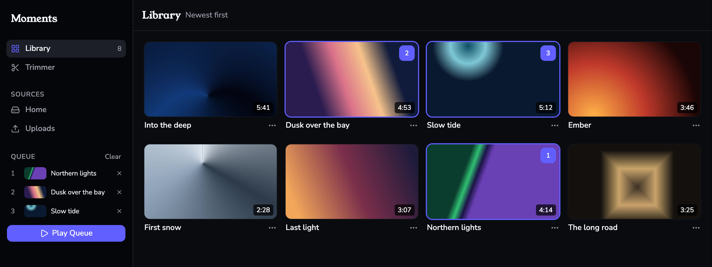
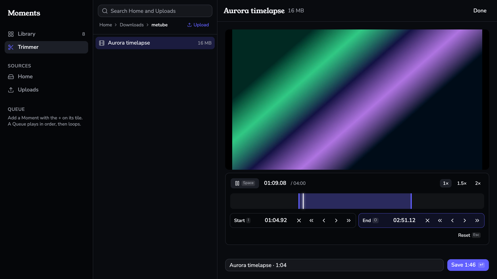
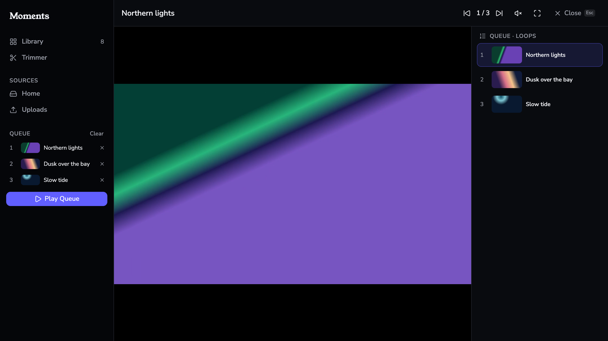

# Moments

Keep the parts of videos you love, and loop them.

Moments is an app for umbrelOS. Mark the start and end of a stretch of any
video in Home, such as a movie or a MeTube download, and keep it as its own
video in Home/Moments, to replay on loop. Moments reads all of Home and changes
nothing in it except Downloads/metube and Moments.

Mark a stretch of a video in the Trimmer, by key or by typing its times, and
save it as a Moment:

Play a Moment on loop, or a Queue of them in order:

## Install

Moments is in Guillem's Apps, a community app store:

1. In umbrelOS, open the App Store.
2. Click the three dots in the top-right corner and select **Community App
   Stores**.
3. Paste `https://github.com/gariasf/umbrel-community-app-store` and click
   **Add**.
4. Click **Open** next to Guillem's Apps, and install Moments.

## This repo

`gariasf/moments-app` holds a snapshot of each release after 0.2.0: one commit
with that release's code, and nothing else. Issues are off.
